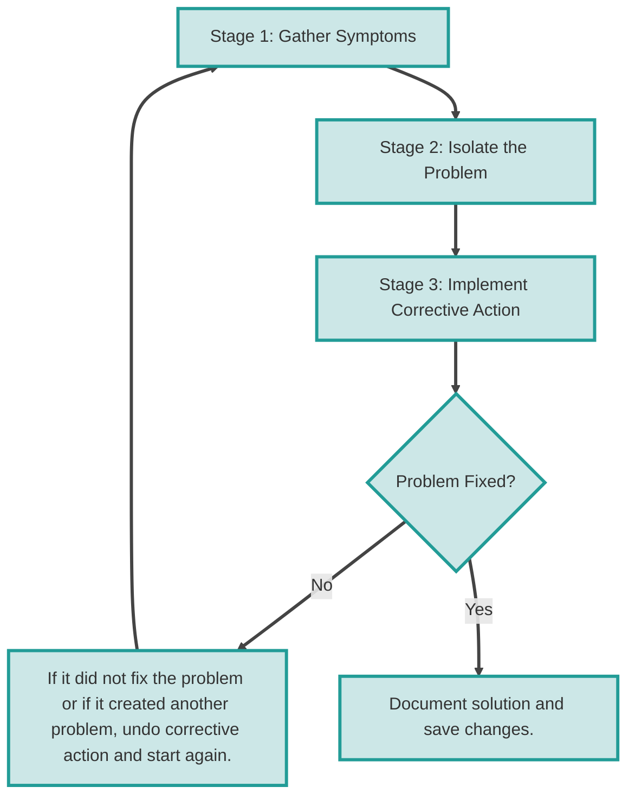

# Module 8 — Troubleshooting the Network

2026-10-10 08:31

Tags: #Network

Author: Duke Hsu

---

## Topics

1. Network Documentation
2. General Troubleshooting Process
3. Layered Troubleshooting Methods
4. Troubleshooting Tools
5. Symptoms and Causes by Layer
6. End-to-End Troubleshooting
7. Terms and Commands

## 1. Network Documentation

Before troubleshooting a network problem, we need to understand how the network operates under normal conditions.

Network documentation should be:

- Up to date
- Complete
- Accurate

### Three Types of Network Documentation

| Document | Content | Purpose |
| --- | --- | --- |
| Configuration Files | Network device and end-device settings | Verify that settings are correct |
| Topology Diagrams | Physical and logical topology | Understand the network structure and connections |
| Network Baseline | Measurements of normal network operation | Compare current performance with normal performance |

### Physical Topology vs. Logical Topology

| Type | Key Point | Examples |
| --- | --- | --- |
| Physical Topology | How devices and cables are physically connected | Device types, models, manufacturers, operating systems, UTP cable specifications, and cable endpoints |
| Logical Topology | How addresses, interfaces, ACLs, and protocols organize communication | IP addresses, prefix lengths, interfaces, connection types, VPNs, routing protocols, static routes, and WAN technologies |

### Steps for Establishing a Network Baseline

1. **Determine the scope:** Identify the area to assess, such as a VLAN, a server group, or the entire network.
2. **Identify the metrics:** Examples include packet loss, latency, jitter, throughput, bandwidth utilization, CPU utilization, and memory utilization.
3. **Select the tools:** Examples include SNMP, flow monitoring, Zabbix, and uptime monitoring.
4. **Collect the data:** For example, collect measurements over 2–4 weeks.
5. **Analyze the data:** Identify traffic patterns and outliers.
6. **Define the baseline:** Establish normal operating ranges and thresholds.
7. **Document the results:** Record the findings for future comparison.
8. **Continuously monitor and update:** Keep the baseline aligned with changes in the network.

## 2. General Troubleshooting Process

| Stage | Name | What to Do |
| --- | --- | --- |
| 1 | Gather Symptoms | Collect symptoms and supporting evidence |
| 2 | Isolate the Problem | Narrow the scope and locate the problem |
| 3 | Implement Corrective Action | Apply measures to correct the problem |

## 3. Layered Troubleshooting Methods

| Method | Approach | Selection Guidelines from the Slides |
| --- | --- | --- |
| **Bottom-up** | Start at the Physical Layer and work upward, layer by layer | Complex problems or problems encountered for the first time |
| **Top-down** | Start at the Application Layer and work downward, layer by layer | Problems with a limited scope |
| **Divide-and-conquer** | Test a selected layer, then investigate higher or lower layers based on the results | Problems similar to those encountered previously |

### Examples

- **Bottom-up:** Check cables and interfaces first, then examine MAC addressing, IP addressing, routing, and applications.
- **Top-down:** If only one application is not working, investigate that application first, then work downward.
- **Divide-and-conquer:** Test IP reachability first, then decide whether to investigate lower-layer connectivity or higher-layer services.

### Other Methods

| Method | Meaning |
| --- | --- |
| Educated Guess | Form an informed hypothesis based on symptoms and experience |
| Comparison | Compare working and nonworking situations to identify differences |
| Substitution | Replace a suspected faulty device with a known working device for testing |

## 4. Troubleshooting Tools

| Category | Tool | Purpose |
| --- | --- | --- |
| Software | NMS Tools | Centrally monitor network devices and their status |
| Software | Knowledge Bases | Look up known issues, documentation, and solutions |
| Software | Baselining Tools | Establish and compare normal performance |
| Software | Host-based Protocol Analyzers | Capture and analyze packets on a host |
| Software | Cisco IOS EPC | Capture packets on supported Cisco IOS devices |
| Hardware | Network Analysis Module | Analyze network traffic and performance |
| Hardware | Digital Multimeters | Measure electrical characteristics such as voltage and resistance |
| Hardware | Cable Testers | Check cable wiring and continuity |
| Hardware | Cable Analyzers | Perform more detailed analysis of cable quality and characteristics |
| Hardware | Portable Network Analyzers | Perform network analysis on-site |

### Syslog Severity Levels

| Level | Keyword | Meaning |
| --- | --- | --- |
| **0** | **emergencies** | The system is unusable |
| **1** | **alerts** | Immediate action is required |
| **2** | **critical** | Critical conditions exist |
| **3** | **errors** | Error conditions exist |
| **4** | **warnings** | Warning conditions exist |
| **5** | **notifications** | A normal but significant event has occurred |
| **6** | **informational** | General informational messages |
| **7** | **debugging** | Debugging messages |

**Memory aid: 0 — unusable; 1 — act now; 2 — critical; 3 — errors; 4 — warnings; 5 — significant events; 6 — information; 7 — debugging details.**

**Remember: Level 5 does not necessarily indicate an error, and Level 7 is not the most severe level. Lower numbers indicate greater severity.**

## 5. Symptoms and Causes by OSI Layer

**The same symptom may originate at different layers. This table provides troubleshooting directions; symptoms alone do not establish a diagnosis.**

| Layer | Symptoms or Troubleshooting Topics Listed in the Slides | Possible Causes or Items to Check Listed in the Slides |
| --- | --- | --- |
| **L1 Physical** | Performance below the baseline, loss of connectivity, congestion or bottlenecks, high CPU utilization, and console errors | Power, hardware, cabling, attenuation, noise, and interface configuration errors |
| **L2 Data Link** | Loss of functionality or connectivity at L3 and above, reduced performance, excessive broadcasts, and console messages | Encapsulation errors, address mapping errors, framing errors, and STP failures or loops |
| **L3 Network** | Network failure and suboptimal performance | Connectivity, neighbors, topology databases, and routing tables |
| **L4 Transport-related Troubleshooting** | ACL issues and NAT compatibility issues | ACL rules, protocol and port selection, and NAT interoperability with other protocols |
| **Upper-layer Application-related Troubleshooting** | Application protocols and their mapping between the OSI and TCP/IP models | Page 26 lists HTTP, Telnet, FTP, SMTP, DNS, and other protocols |

### Key ACL Checks

- Correct selection of traffic flow
- **Order of ACL entries**
- **Implicit deny all**
- Addresses and IPv4 wildcard masks
- Selection of the transport-layer protocol
- Source and destination ports
- Use of the `established` keyword
- Uncommon protocols

### NAT Interoperability Areas

BOOTP/DHCP, DNS/WINS, SNMP, and tunneling/encryption protocols.

**Additional explanation:** The slides discuss ACLs and NAT under Transport Layer Troubleshooting. This does not mean that they involve only L4; IP addresses and upper-layer protocol behavior also need to be considered.

**Memory aid: L1 — cables and signals; L2 — frames and address mappings; L3 — paths; L4 — connections and ports; upper layers — services.**

## 6. Eight Steps for End-to-End Troubleshooting

When there is no end-to-end connectivity and the administrator chooses a bottom-up approach, the following are common troubleshooting steps:

| Step | Checkpoint | What to Check | Commands or Methods |
| --- | --- | --- | --- |
| **1** | Verify the Physical Layer | Cables, hardware, interfaces, and error counters at the point where communication stops | Visual inspection and hardware testing tools |
| **2** | Check for Duplex Mismatches | Whether speed and duplex settings are compatible at both ends of the connection | Check interface status and settings |
| **3** | Verify Layer 2 and Layer 3 Addressing on the Local Network | IPv4 ARP, IPv6 neighbor information, MAC address tables, and VLAN assignments | `ping`, `ipconfig`, `ip route`, and `arp`, as appropriate to the platform and test |
| **4** | Verify Default Gateway | Whether the default gateway is configured correctly | `ipconfig`, `route print`, and `show ip route` |
| **5** | Verify Correct Path | Whether devices forward traffic along the correct path | `tracert` / `traceroute` |
| **6** | Verify the Transport Layer | Whether transport-layer connections work; the slides use Telnet | TCP tests with `psping`, `tcping`, or `telnet`; see the clarification below |
| **7** | Verify ACLs | Whether any ACL blocks the traffic | `show access-lists` |
| **8** | Verify DNS | Whether DNS settings are correct and a DNS server is reachable | `nslookup` |

**Technical clarification:** The original notes also listed `ping` in Step 6. It tests ICMP reachability, not TCP or UDP service availability directly. Tool behavior depends on the selected options. The `ip route` command in Step 3 also depends on the platform: on Linux it can display routes, whereas Cisco IOS uses `show ip route` to display the IPv4 routing table.

**Eight-step memory aid: Physical → Duplex → Addressing → Gateway → Path → Transport → ACL → DNS.**

## 7. Terms and Commands

### 7.1 Terms

| Term | Plain-English Meaning | Simple Definition |
| --- | --- | --- |
| Troubleshooting | Systematic problem solving | Identify and correct problems systematically |
| Baseline | Normal reference conditions | A reference for comparison during normal operation |
| Symptom | Observable sign of a problem | An abnormal condition that can be observed |
| Physical / Logical Topology | Physical connections / logical structure | The actual device connections and the logical organization of the network |
| Bottom-up / Top-down | Work upward / work downward | Investigate problems layer by layer |
| Divide-and-conquer | Narrow the search through testing | Use test results to reduce the troubleshooting scope |
| Syslog Severity | Message severity level | Classify messages using levels 0–7 |
| Attenuation | Signal weakening | A reduction in signal strength |
| Noise | Signal interference | Unwanted signals that interfere with transmission |
| Duplex Mismatch | Inconsistent duplex modes | The two ends of a connection use different duplex modes |
| Default Gateway | Default next hop | The default next hop a host uses to reach other networks |
| ACL | Access Control List | Rules that permit or deny traffic |
| NAT | Network Address Translation | Translation of IP addresses in packets |

### 7.2 Commands

| Command | Environment | Purpose |
| --- | --- | --- |
| `ping` | Hosts / network devices | Send Echo Requests and observe the responses |
| `traceroute` | Devices supporting this command | Trace the path packets take through the network |
| `telnet` | Hosts / network devices | Establish a Telnet connection; used in this chapter for transport-layer testing |
| `show ip interface brief` | Cisco IOS | Display a summary of IPv4 interfaces |
| `show ipv6 interface brief` | Cisco IOS | Display a summary of IPv6 interfaces |
| `show ip route` | Cisco IOS | Display the IPv4 routing table |
| `show ipv6 route` | Cisco IOS | Display the IPv6 routing table |
| `show running-config` | Cisco IOS | Display the currently running configuration |
| `show protocols` | Cisco IOS | Display configured protocols and Layer 3 status |
| `show interfaces gigabitethernet 0/0` | Cisco IOS | Display the status and statistics of the specified interface |
| `show mac address-table` | Devices supporting switching functions | Display the MAC address table |
| `arp` | PC | Perform ARP-related operations; the exact action depends on the parameters |
| `netsh interface ipv6 show neighbor` | Windows | Display IPv6 neighbor information |
| `show ipv6 neighbors` | Cisco IOS | Display the IPv6 neighbor table |
| `route print` | Windows | Display the routing table |
| `ipconfig` | Windows | Display IP configuration, including the default gateway |
| `ip host …` / `ipv6 host …` | Cisco IOS configuration mode | Create local static hostname-to-address mappings |

---

## References

